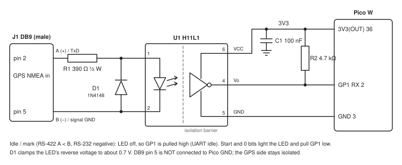

# Pico W collector enclosure

A 3D-printed box for the Pico W NMEA collector (`firmware/pico_nmea_tracker/`),
powered from a 120 VAC outlet through an ordinary USB wall adapter, with an
opto-isolated NMEA 0183 input.

- **Front:** DE-9 (DB9) male panel connector for the GPS NMEA input.
- **Back:** panel-mount USB-C for 5 V power. If the panel cable carries data,
  this port also gives you the `CIRCUITPY` drive and the serial console without
  opening the box.
- **Lid:** four M3 self-tapping screws into the printed corner bosses. Open it
  for BOOTSEL or rewiring.
- **Mounting:** slotted ears for #8/M4 screws (set `ears = false` to leave them off).

The box is splash-resistant at most. It has no gasket, so mount it somewhere dry
(the lab or the bridge, not on deck).

## Files

`enclosure.scad` is a parametric OpenSCAD model. Set `part` to `"box"` or `"lid"`
and export each one to STL. Customizer groups:
`[Box]`, `[Lid]`, `[Pico W]`, `[Interface board]`, `[Ports]`, `[Mounting ears]`.

**Measure your panel connectors before you print.** USB-C panel-mount flanges
differ between vendors (`usb_screw_dx`, `usb_cut`). For a round threaded
bulkhead, set `usb_style = "round"` and `usb_round_d`. A DE-9 cutout is standard.

Print settings: PETG or ASA (PLA softens in a hot wheelhouse), 0.2 mm layers,
3 walls, 20 % infill. Print the box open side up and the lid plate side down.
Neither part needs supports.

## Bill of materials

See [BOM.md](BOM.md): parts for one unit, with rough prices (about $40).

## GPS input: opto-isolated NMEA 0183



The GPS drives the LED of an H11L1 optocoupler. The Pico only sees the output
side, so **the GPS and the Pico share no ground**. That is the input NMEA 0183
specifies for a listener, and it keeps ship ground loops and noise off the Pico.
The same circuit accepts RS-422 (standard marine NMEA) and RS-232.

**DB9 pinout** (same as a PC serial port, so a standard RS-232 GPS cable plugs in):

| DB9 pin | RS-422 / NMEA 0183 | RS-232 |
| --- | --- | --- |
| 2 | A (+, sometimes "TX+" or "NMEA OUT+") | GPS TxD |
| 5 | B (−, "TX−" or "NMEA OUT−") | GPS signal ground |

Bare NMEA wires go into a DB9 screw-terminal adapter.

**Parts** (on the 3 × 7 cm perfboard):

| Ref | Part | Job |
| --- | --- | --- |
| U1 | H11L1 optocoupler (6-pin DIP, use a socket) | isolation and a clean Schmitt-trigger output |
| R1 | 390 Ω, ½ W | limits LED current: about 2 mA at the RS-422 minimum (±2 V), about 25 mA at RS-232 ±12 V |
| D1 | 1N4148 | across the LED, reversed; clamps reverse voltage to about 0.7 V when the line swings negative |
| R2 | 4.7 kΩ | pull-up for the H11L1's open-collector output |
| C1 | 100 nF ceramic | decouples H11L1 VCC, mounted close to pin 6 |

**Connections**

| From | To |
| --- | --- |
| DB9 pin 2 | R1 → H11L1 pin 1 (LED anode) and D1 cathode |
| DB9 pin 5 | H11L1 pin 2 (LED cathode) and D1 anode |
| H11L1 pin 6 (VCC) | Pico 3V3(OUT), physical pin 36; C1 to Pico GND |
| H11L1 pin 4 (Vo) | Pico GP1 (UART0 RX), physical pin 2; R2 to 3V3 |
| H11L1 pin 5 (GND) | Pico GND, physical pin 3 |

DB9 pin 5 must **not** connect to Pico GND. That connection would defeat the isolation.

**How it works.** At idle (mark), RS-422 holds A below B and RS-232 sits at a
negative voltage, so the LED is off and R2 pulls GP1 high, which is UART idle.
Start bits and 0 bits drive A above B (or RS-232 positive), so the LED lights
and the H11L1 pulls GP1 low. The H11L1 inverts its input, and the line levels are
also inverted relative to TTL, so the two cancel out. That gives correct UART
polarity with no firmware change: `code.py` reads GP1 at `NMEA_SERIAL_BAUD`
(4800 by default; the H11L1 is fast enough for 38400 AIS too).

**Bench check before connecting the GPS.** With the Pico powered and nothing on
the DB9, GP1 should measure about 3.3 V. Put 5 V on pin 2 relative to pin 5
(through R1, as built), and GP1 should drop to about 0 V.

**Limits.** This circuit does not handle 3.3 V/5 V TTL sources: they idle high,
which would light the LED and invert the data. Wire a TTL source directly to GP1
instead (main README). The RS-422 minimum swing of ±2 V is close to the H11L1's
1.6 mA turn-on current. If a weak talker gives garbled sentences, drop R1 to 270 Ω.

## Assembly

1. Pre-tap the four corner bosses by driving an M3 screw in and back out once.
   When refitting the lid later, turn each screw backwards until it clicks into the
   existing thread before tightening, so it doesn't cut a new one. Don't overtighten.
2. Mount the DB9 (front) and USB-C panel connector (back).
3. Build the interface board and screw it and the Pico onto their standoffs.
   The Pico's USB end faces the back wall.
4. Plug the panel cable's micro-USB end into the Pico. Wire the DB9 to the
   interface board and the interface board to the Pico.
5. Test with the lid open: run `scripts/simulate_nmea_source.py --serial` through
   a USB-RS-232 adapter into the DB9 (README "Pico W firmware") and watch the
   serial console. Then screw the lid on.

## Firmware access

With a data-capable panel cable, plug a laptop into the USB-C port instead of the
wall adapter. `CIRCUITPY` mounts and the serial console works with the lid
closed. You only need to open the lid for BOOTSEL, which is required just for
reflashing CircuitPython itself. Even that can usually be avoided from the REPL:

```python
import microcontroller
microcontroller.on_next_reset(microcontroller.RunMode.UF2)
microcontroller.reset()
```
